# Тапёр

  
  
  
  

> [!WARNING]
> **Тапёр находится на стадии бета-теста.** Программа уже работает на стримах, но в ней могут быть ошибки.
> Нашли проблему — напишите в Telegram-чат или откройте задачу в [Issues](https://github.com/alexshikaka/tapyor/issues).
> *Tapyor is in public beta: it works on live streams, but bugs are possible.*

Музыкальный плеер для Windows. Играет Яндекс Музыку, YouTube, SoundCloud, Audius и файлы с компьютера в одной
очереди. Для стримеров принимает заказы песен из донатов (DonationAlerts, DonatePay), из чата Twitch (через
Streamer.bot или свой чат-бот) и выводит музыку в OBS.

- Сайт и живые примеры оверлеев: https://alexshikaka.github.io/tapyor-web/
- Скачать: [последний релиз](https://github.com/alexshikaka/tapyor/releases/latest)
- Статус: **открытая бета**. Программа работает на стримах, но может ломаться.

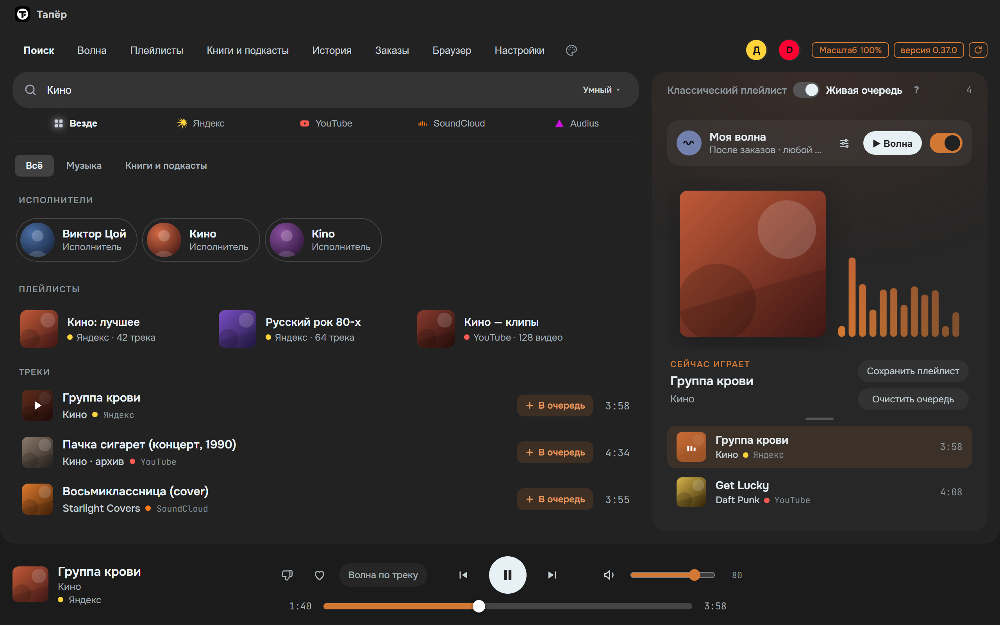

Снимки сделаны с выдуманными данными: ники зрителей, суммы и заказы — пример.

## Содержание

- [Что бесплатно, что платно](#что-бесплатно-что-платно)
- [Площадки и воспроизведение](#площадки-и-воспроизведение)
- [Поиск](#поиск)
- [Очередь](#очередь)
- [Плейлисты и перенос из других сервисов](#плейлисты-и-перенос-из-других-сервисов)
- [Заказы из донатов](#заказы-из-донатов)
- [Заказы из чата Twitch](#заказы-из-чата-twitch)
- [OBS](#obs)
- [Оформление](#оформление)
- [Надёжность и обновления](#надёжность-и-обновления)
- [Пак стримера](#пак-стримера)
- [Установка](#установка)
- [Данные и безопасность](#данные-и-безопасность)
- [Связь](#связь)
- [Для разработчиков](#для-разработчиков)
- [English](#english)

## Что бесплатно, что платно

Ядро — это весь плеер. Оно бесплатное, с открытым кодом (MIT) и работает без пака.

| Ядро — бесплатно | Пак стримера — первый месяц бесплатно, потом $10 один раз ([GGSel](https://ggsel.net/catalog/product/104388863)) |
|---|---|
| Все площадки, поиск, очередь, «Моя волна», плейлисты, импорт | 26 стилей оверлея-плейлиста и моушн-оверлей для OBS |
| Заказы из донатов: DonationAlerts, DonatePay | Свой чат-бот Twitch: `!play`, заказы за баллы канала, события заказов |
| Заказы из чата через Streamer.bot | Автоматизация заказов из чата: лимиты, паузы, блокировки, ответы зрителям |
| Док-панель OBS, `now_playing.txt`, сайт-визитка со ссылкой на донат | |
| Темы, оболочки, редактор тем, знакомство при первом запуске, обновления | |

Подробности о паке — [ниже](#пак-стримера).

## Площадки и воспроизведение

| Площадка | Как работает |
|---|---|
| **Яндекс Музыка** | Вход своим аккаунтом. Полные треки — с подпиской Плюс, без неё — отрывки. «Моя волна» с настройками, лайки и дизлайки, свои плейлисты, альбомы, книги и подкасты. |
| **YouTube и YouTube Music** | Поиск и воспроизведение, если YouTube у тебя открывается. Вход аккаунтом Google — по желанию (нужен для своих плейлистов). Качество видео настраивается. |
| **SoundCloud** | Без входа, в том числе потоковые (HLS) треки. |
| **Audius** | Без входа. |
| **Bandcamp** | По ссылкам. |
| **Свои файлы** | Папки с музыкой на компьютере: MP3, FLAC, OGG, M4A, WAV, теги и длительность читаются без сторонних библиотек. Файлы никуда не загружаются. Экспорт плейлистов в M3U. |
| **Книги и подкасты** | Подписки, «Слушаю сейчас», новые выпуски, история. Книга в очереди не разбивается на главы. |

Воспроизведение:

- **Ровная громкость** — по данным громкости Яндекса треки только приглушаются, а не усиливаются.
- **Плавный переход** между треками.
- **Готовить следующий трек заранее**, чтобы между песнями не было паузы.
- **Запасные пути:** если поток не получен или не играет, Тапёр пробует сайт Яндекс Музыки, встроенный плеер
  YouTube или тот же трек на другой площадке.
- **Визуализатор** и режим «на весь экран».
- **Медиаклавиши** клавиатуры и горячие клавиши.
- **Вкладка «Браузер»** — встроенный браузер со своим масштабом для каждого сайта. Из него можно собрать песни
  со страницы (например, свою музыку ВКонтакте).
- **VPN и Яндекс.** Если Яндекс Музыка не открывается при включённом VPN, раздел «VPN и Яндекс» показывает
  список сетей Яндекса, которые нужно пустить мимо VPN.

## Поиск

- Один запрос ищет сразу на всех включённых площадках; можно выбрать одну площадку.
- Выдача: исполнители, плейлисты, треки, книги и подкасты.
- Одинаковые версии одной песни с разных площадок склеиваются в одну строку («+12 версий»).
- Режимы выдачи:
  - **Умный** — точные совпадения с площадок, где есть полный доступ;
  - **По точности** — что сильнее всего совпадает с запросом, с любой площадки;
  - **Сначала мои подписки** — Яндекс с Плюсом, YouTube со входом, отрывки ниже;
  - **Сначала бесплатные** — SoundCloud, Audius, YouTube, Яндекс ниже;
  - **По площадкам** — разделами, в порядке из настроек.
- Порядок площадок и «Свои файлы в поиске» настраиваются.
- Страница исполнителя: треки и альбомы Яндекса, дискография Deezer, описание, теги и похожие с Last.fm
  (Last.fm из России обычно открывается только через VPN).

## Очередь

- **Живая очередь** — заказы встают по своим правилам и приоритетам, ты в любой момент перетаскиваешь треки
  руками. **Классический плейлист** — обычный порядок без перестановок.
- **Включать фон, когда очередь закончилась:** «Моя волна» или выбранный плейлист, чтобы на стриме не было тишины.
- Заказы в очереди помечены цветом по источнику (донат, баллы, чат) и ником заказавшего.
- «Сохранить плейлист» и «Очистить очередь»; очередь и позиция переживают перезапуск.

## Плейлисты и перенос из других сервисов

- **Свои плейлисты Тапёра** — из треков любых площадок вперемешку.
- **Импорт** (кнопка «Импорт» во вкладке «Плейлисты»):
  - **Из текста** — список песен по строке, в любом виде («1. Кино — Группа крови», «сплин выхода нет»);
  - **По ссылке** — Яндекс Музыка, YouTube (в том числе главы и списки в описании видео), SoundCloud, Spotify,
    Apple Music, Deezer;
  - **Из файла** — экспорт чата Telegram (JSON или HTML), таблицы CSV (Exportify, TuneMyMusic, Soundiiz);
  - **ВКонтакте** — музыка открывается во вкладке «Браузер», песни собираются кнопкой «Собрать песни».
- Где искать песни: **Авто** — там, где трек играет целиком; **только Яндекс**; **только YouTube**.
  Отрывки и ненайденные строки помечаются.
- **Сначала свои файлы:** если песня есть на компьютере, при сборе плейлиста берётся она.
- **Перенос плейлиста на площадку** — в свои плейлисты Яндекс Музыки или YouTube.
- Исправление «кракозябр» (cp1251) в названиях своих плейлистов — по кнопке, без потерь.

## Заказы из донатов

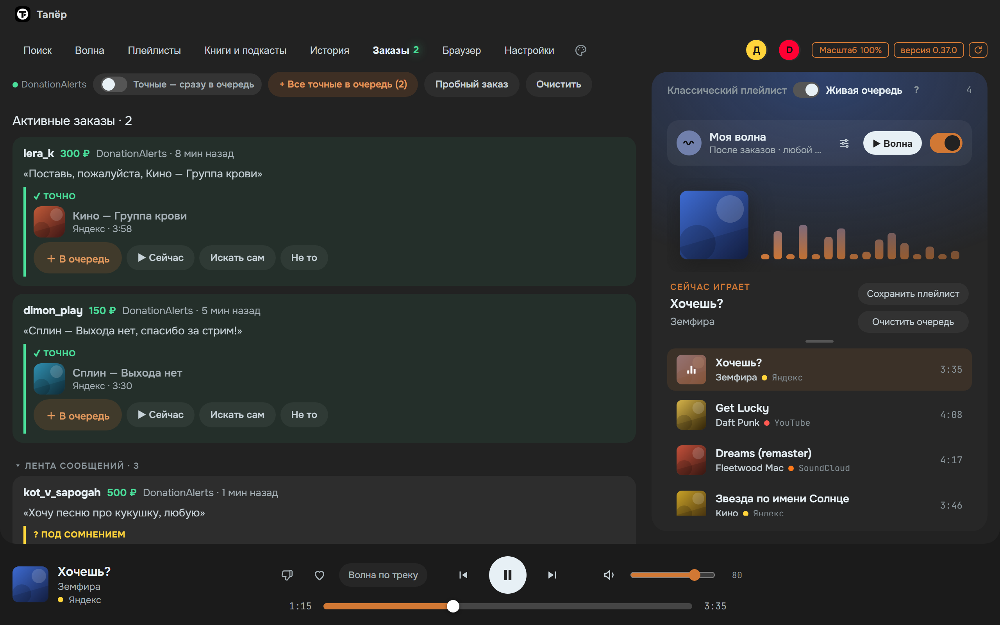

- Подключение: **DonationAlerts** (вход через их сайт) и **DonatePay** (токен из личного кабинета). Ключи хранятся
  на компьютере в зашифрованном виде.
- Тапёр вытаскивает песню из текста доната (приветствия, смайлики, тире без пробелов, «поставь пожалуйста»),
  ищет её на площадках и ставит вердикт:
  - **✓ точно** — название и исполнитель совпали;
  - **сомнение** — нашлось похожее, заказ ждёт кнопок «В очередь», «Сейчас», «Искать сам», «Не то».
  Ссылки на Яндекс Музыку, YouTube и SoundCloud в донате принимаются сразу.
- Пометки спорных треков: слишком длинный, 18+, стоп-лист, «не музыка?», «троллинг?», не та версия (ремикс,
  sped up, кавер и т. п.).
- Правила: **цена за трек** (сколько песен оплачено суммой), **самый длинный трек**, **стоп-лист**, **мат (18+)
  можно**, **повторять уже игравшие**, **каверы и другие версии**, **где искать заказы**.
- **Точные — сразу в очередь:** точные совпадения встают в очередь без подтверждения.
- Донаты в другой валюте пересчитываются по курсу ЦБ РФ.
- **Пробный заказ** проходит тот же путь, что настоящий донат, но деньги никуда не двигаются.
- Приоритеты заказов: кто идёт первым — донаты, баллы канала или команды из чата.

## Заказы из чата Twitch

Два способа, работает один из них: **Streamer.bot** (бесплатно, в ядре) или **свой чат-бот** (пак стримера).
Переключаются одним тумблером «Принимать заказы» — он показан и на экране Streamer.bot, и в «Модули → Чат-бот».

### Через Streamer.bot

Тапёр и Streamer.bot связываются на твоём компьютере через `127.0.0.1` — наружу ничего не уходит. Настройки
команд хранятся в самом Streamer.bot, Тапёр их показывает и записывает.

**Что получится**

| Зритель пишет | Что происходит |
|---|---|
| `!sr кино кукушка` | Тапёр ищет трек, ставит в очередь и отвечает: «@ник поставил: КИНО — Кукушка, через ~N мин. Если песня не та — !cancel» |
| `!song` | «Сейчас играет: …» или «Сейчас ничего не играет» |
| `!place` | место зрителя в очереди и время до его трека |
| `!cancel` | снимает свой **ожидающий** заказ (играющий не снимается) |
| `!skip` | пропускает трек — только стример и модераторы |
| награда «Заказать песню» | заказ за баллы канала; баллы возвращаются, если трек не нашёлся или не заиграл |

**Что нужно заранее**

1. Streamer.bot 1.0.7 или новее, в нём подключён твой Twitch-канал.
2. Тапёр 0.35 или новее, запущен.
3. Проверять команды — в **своём** чате Twitch: в чужом шаблон не отвечает.

> Если у тебя уже есть бот, который ставит песни по `!sr` (Nightbot и подобные), выключи у него заказы песен
> или поменяй команду Тапёра в «Конструкторе» (например, на `!заказ`) — иначе ответят оба.

**Шаг 1. Включи WebSocket-сервер в Streamer.bot.** Делается один раз.

1. Streamer.bot → слева **Servers/Clients → WebSocket Server**.
2. Галочки **Auto Start**, **Authentication** и **Enforce** (без пароля другие программы не подключатся).
3. Придумай отдельный пароль и впиши в **Password** (не пароль от Twitch).
4. **Start Server**. Адрес и порт обычно уже `127.0.0.1` и `8080`.

**Шаг 2. Подключи Тапёр.**

1. Тапёр → **Настройки → Стримерам** (переключатель «Стримерам» включён) → **Streamer.bot** → вкладка **Подключение**.
2. Проверь адрес `127.0.0.1` и порт `8080`, впиши пароль из шага 1 → **Подключиться**.
3. Должно появиться «связь есть · Streamer.bot 1.0.7» и справа твой ник Twitch. «Шаблон не найден» на этом
   шаге — нормально.

Если «Streamer.bot не отвечает» — проверь, что нажат **Start Server**, пароль совпадает и обе программы на одном
компьютере. Чужой адрес Тапёр не принимает.

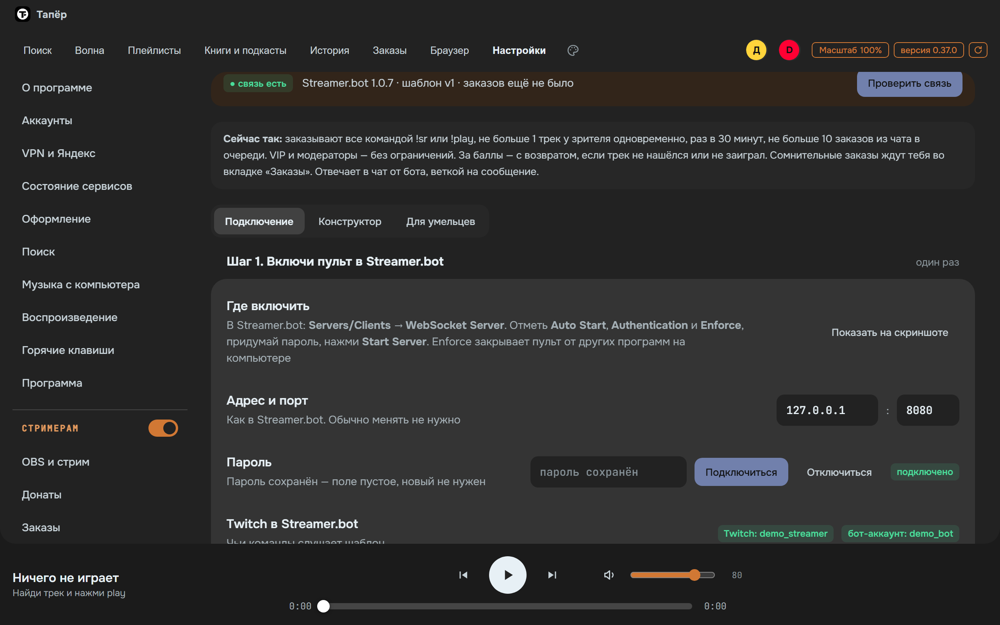

**Шаг 3. Добавь шаблон** — готовые действия и триггеры, собирать руками ничего не нужно.

1. В Тапёре на вкладке **Подключение** → **«Скопировать шаблон»**.
2. В Streamer.bot → **Import** → вставь строку (`Ctrl+V`) → **Import**.
3. Streamer.bot предупредит про код C# в шаблоне — это действия Тапёра, нажми **Yes**.
4. Появится группа действий **«Тапёр»** с действиями «Тапёр: …» и «Тапёр: шаблон v1».
5. **Перезапусти Streamer.bot** — появятся триггеры **Custom → Тапёр** («Заказ принят», «Заказ заиграл» и др.).
6. В Тапёре → **«Проверить связь»**: «связь есть, обе стороны работают», шаблон — «найден · v1».

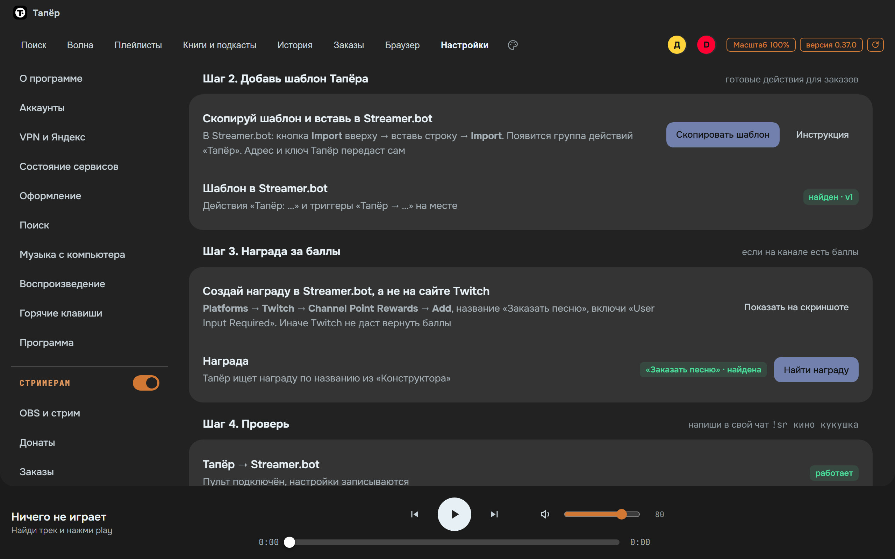

Действия «Тапёр: …» не правь: при обновлении шаблона импорт их перезаписывает. Свои шаги добавляй в свои
действия на триггерах Custom → Тапёр.

**Шаг 4. Награда за баллы** — по желанию; команды работают и без неё. Награды доступны каналам-компаньонам.

1. Streamer.bot → **Platforms → Twitch → Channel Point Rewards → Add**, название «Заказать песню»,
   включи **User Input Required**. Создавай награду **в Streamer.bot**, а не на сайте Twitch — иначе баллы
   не смогут вернуться.
2. Тапёр → **Конструктор → Название награды** — то же название → **«Записать в Streamer.bot»**.
3. Вкладка **Подключение** → **«Найти награду»** → «… · найдена».

Баллы списываются сразу и возвращаются, если трек не заиграл: не нашёлся, не подошёл по правилам, его убрали
или Тапёр был закрыт (тогда — при следующем запуске).

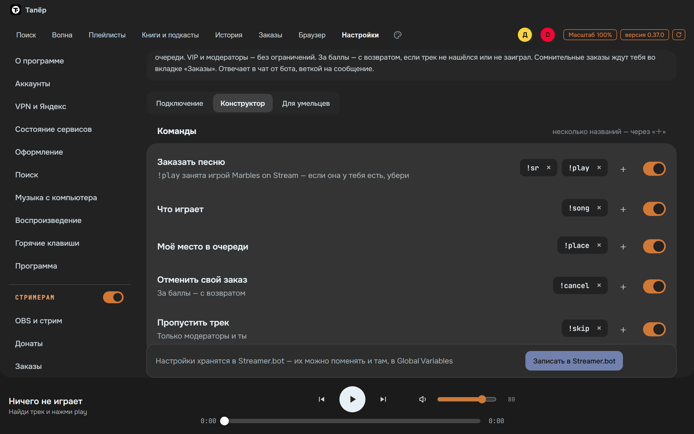

**Конструктор** — команды (`!sr`, `!play` или свои), лимиты (треков на зрителя, потолок очереди, пауза),
права (VIP и модераторы без ограничений), что делать с сомнительным заказом (ждать стримера или спросить
зрителя), тексты ответов. После правок — **«Записать в Streamer.bot»**.

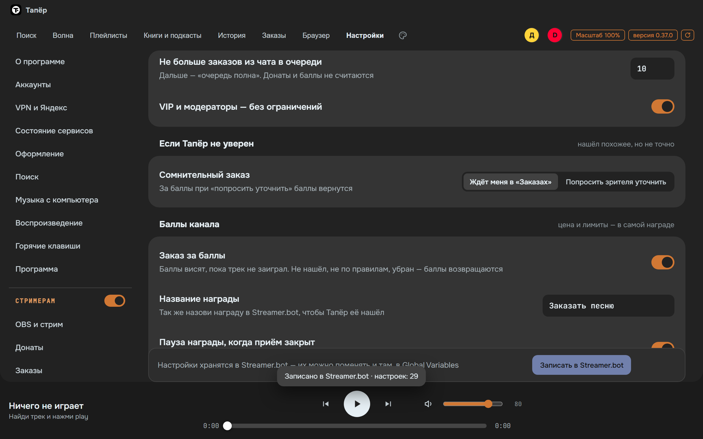

**Шаг 5. Проверь в своём чате:** `!sr кино кукушка`, `!song`, `!place`, `!cancel`, `!skip`. Если очередь пуста,
заказ заиграет сразу: «ставлю: … — играет сейчас».

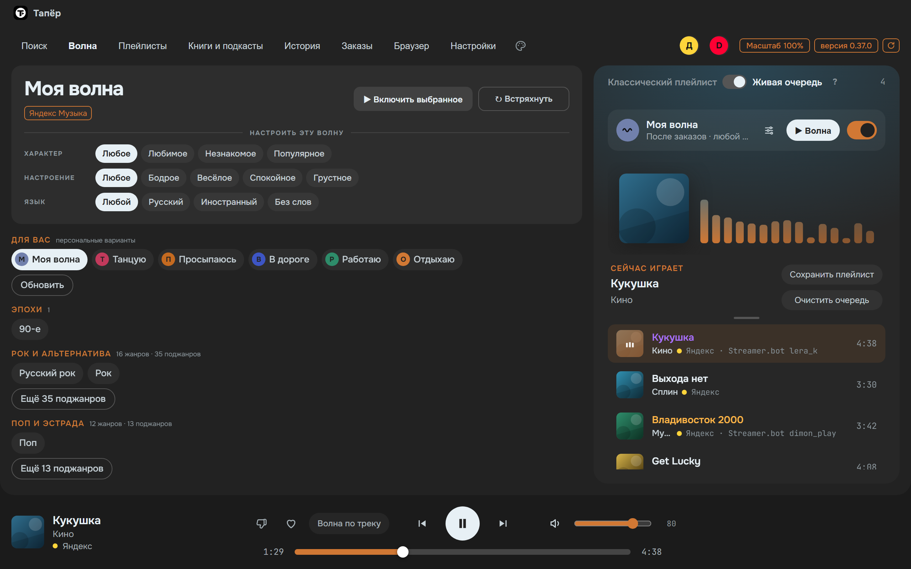

**Если команды отвечают дважды**

- Другой бот тоже ставит песни по `!sr` — выключи у него заказы или поменяй команду Тапёра в «Конструкторе».
- `!play` занята игрой Marbles on Stream — убери `!play` из команды заказа.
- Включены и бот пака, и Streamer.bot — оставь приём заказов у одного (тумблер «Принимать заказы»).

**Если шаблон отвечает «Плеер сейчас не принимает заказы»** — проверь по порядку: Тапёр запущен; тумблер
«Принимать заказы» включён; заказы из чата принимает Streamer.bot, а не бот пака; связь есть; шаблон «найден ·
v1»; нужная команда включена в «Конструкторе». Поиск идёт до 8 секунд; если не успел, Тапёр пишет «ищу … —
отвечу в чате» и присылает ответ позже. Что пошло не так — видно в `log.txt` (Настройки → Программа → Открыть
папку данных), строки «Streamer.bot: …»; пароля и ключа в журнале нет.

**Вернуться на бота пака** — выключи «Принимать заказы» на экране Streamer.bot или включи его в
«Модули → Чат-бот». Шаблон Streamer.bot тогда молчит, а награда за баллы ставится на паузу.

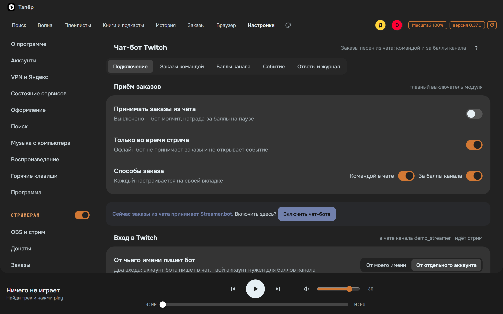

**Обновить шаблон** — когда на экране «найден · v1 · есть новее v2»: «Скопировать шаблон» → Import в
Streamer.bot → перезапуск Streamer.bot → «Проверить связь». Твои собственные действия не трогаются.

**Чего не делать:** не переименовывать группу «Тапёр» и действия «Тапёр: …»; не вписывать адрес и ключ Тапёра
в шаблон руками (Тапёр передаёт их сам); не показывать ключ порта `tp_…` на стриме; не запускать два
Streamer.bot и два приёмщика заказов сразу.

**Данные.** Пароль пульта и ключ порта хранятся зашифрованными. Журнал заказов из Streamer.bot лежит в папке
данных 7 дней и никуда не отправляется; ники и тексты заказов есть только в нём.

**Для умельцев.** Ссылки `/sb/*` (заказ, отмена, что играет, место, следующие треки, управление плеером, приём
заказов), ответы плоским JSON и триггеры `tapyor_order_queued`, `tapyor_order_played`, `tapyor_queue_empty`
и другие — для своих действий: кнопка «пропустить» на Stream Deck, алерт в OBS на заказ, смена сцены, когда
заказы кончились. Всё это описано в [docs/STREAMERBOT-GUIDE.md](docs/STREAMERBOT-GUIDE.md) и на вкладке
«Для умельцев» в Тапёре.

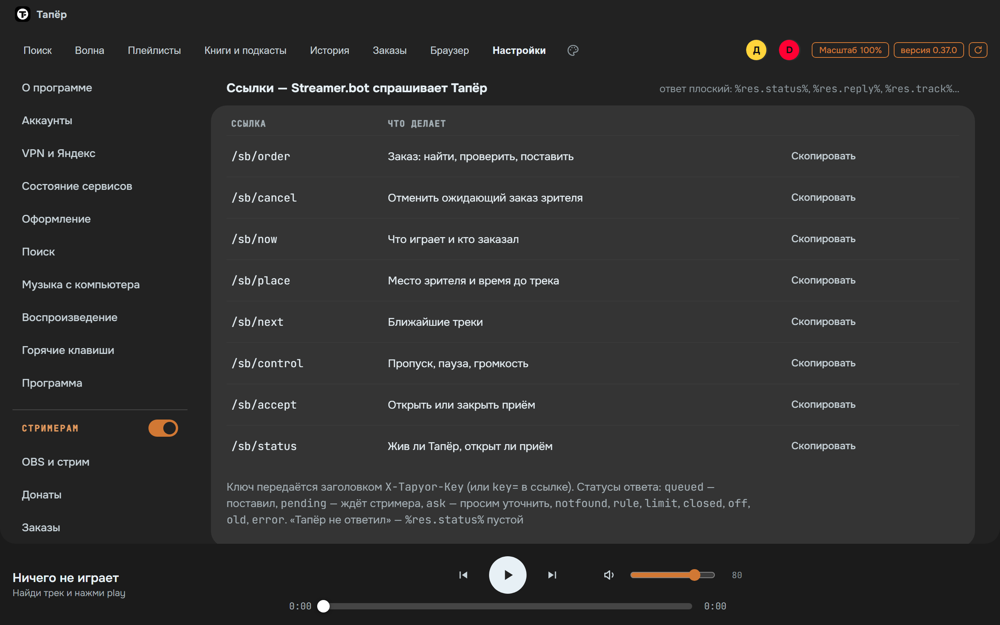

### Свой чат-бот (пак стримера)

- Вход через Twitch (код на сайте Twitch, пароль Тапёр не видит), от своего имени или от отдельного аккаунта.
- `!play исполнитель — название` или ссылка; заказы за баллы канала с возвратом баллов.
- Приём заказов **всегда** или **по событию**: бот объявляет «Событие заказов!» и разыгрывает треки среди заявок.
- Пауза после заказа, потолок очереди, блокировка зрителя по правому клику в очереди, тексты ответов.
- Первый месяц бесплатно, дальше — в составе пака стримера.
- Инструкция: [docs/BOT-GUIDE.md](docs/BOT-GUIDE.md).

## OBS

- **Панель для OBS** (пользовательская док-панель): заказы, кнопки плеера, сообщения; свой масштаб и цвета.
- **Название трека в файл** `now_playing.txt` — для текстового источника OBS.
- **Сайт-визитка** — страница с кнопками доната и инструкцией, как заказать песню, и QR-код для сцены.
- **Оверлеи** (пак стримера) — страница для источника «Браузер»: что играет и что дальше в очереди, ник
  заказавшего. Подробнее — [docs/OVERLAY.md](docs/OVERLAY.md).

## Оформление

  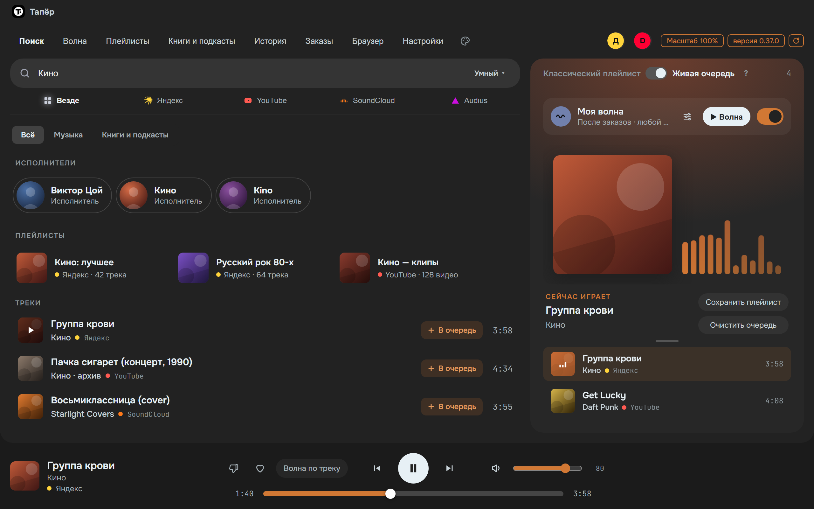
  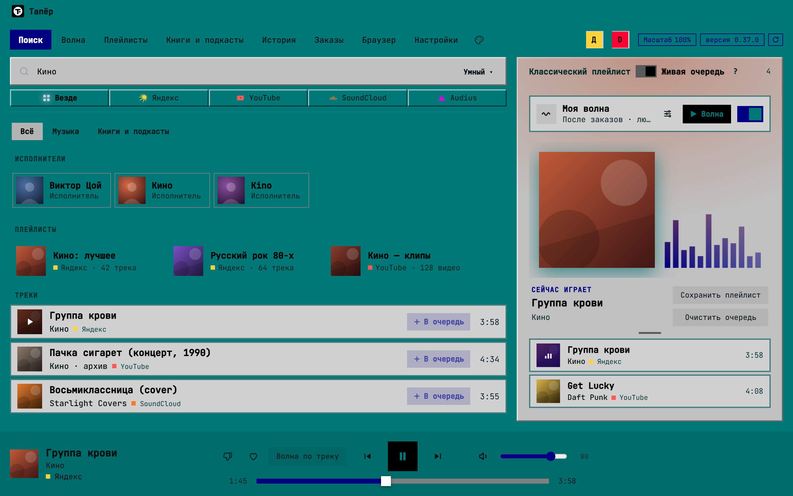

- **Восемь тем**, парами тёмная — светлая: Графит (по умолчанию), Монохром, Зима близко, Маджента.
- **Редактор тем:** своя тема из пяти цветов, подбор вариантов, светлый вариант, копия.
- **Оболочки** меняют вид окна целиком: VGA / DOS, Неон-скан (CRT), Ретро-десктоп. У оболочек свои наборы цветов
  и шрифтов.
- **Масштаб интерфейса.**
- **Знакомство при первом запуске:** окно-колонка с шагами для слушателя или для стримера (входы, донаты,
  правила заказов, OBS, чат). Пройти заново — «Настройки → О программе».

## Надёжность и обновления

- **Быстрая проверка при запуске** и **состояние сервисов**: что работает, что нет и что сделать.
- **Автопочинка:** одна попытка на службу; тяжёлые починки ждут паузы между треками.
- **Сторож окна:** если окно упало или зависло, Тапёр поднимает его и продолжает с того же места.
- **Обновления** проверяются подписью Ed25519 до установки. Каналы: «Стабильная» (этот репозиторий) и «Отладочная».
- Ставить обновления сами, запуск вместе с Windows, сворачивание в трей.
- **Сообщить об ошибке** — из «О программе»; отчёт без личных данных.
- Отладочное меню — `tapyor debug` в поиске: состояние служб, нагрузка, журнал, отчёт.

## Пак стримера

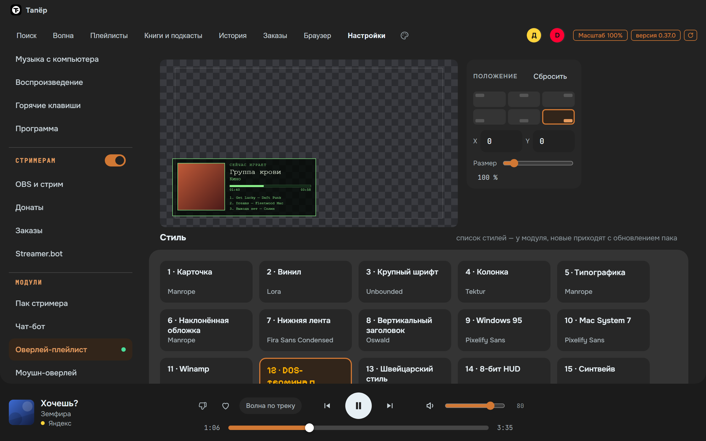

- Состав: оверлей-плейлист (26 стилей), моушн-оверлей, чат-бот Twitch.
- **Первый месяц бесплатно:** 30 дней со всеми функциями, без карты и без ключа. Отсчёт начинается при нажатии
  «Попробовать».
- Дальше — **$10 один раз**, ключ на 3 компьютера: [купить на GGSel](https://ggsel.net/catalog/product/104388863). Ключ вводится в «Настройки → Модули → Пак стримера».
- Ставится из программы кнопкой «Установить» («Настройки → Модули → Пак стримера»), проверяется подписью.

### Аудит пака

Код пака открыт для проверки: **[alexshikaka/tapyor-modules](https://github.com/alexshikaka/tapyor-modules)**.
Пак работает с твоим аккаунтом Twitch, поэтому его можно и нужно проверить перед покупкой.

- Чат-бот — `streamer-pack/bot/`, разрешения Twitch и зачем каждое — `streamer-pack/bot/src/twitch/config.js`
  и README репозитория.
- Оверлеи — `streamer-pack/overlay/`: страница для OBS только читает состояние плеера и ничего не может нажать в Тапёре.
- Пак ставится подписанным файлом `.tpack` из релизов `tapyor-modules`; Тапёр проверяет подпись перед установкой.
- Нашёл проблему безопасности — по [SECURITY.md](SECURITY.md).

## Установка

1. Скачай `Tapyor-Setup-….exe` из [последнего релиза](https://github.com/alexshikaka/tapyor/releases/latest).
2. Запусти. Windows покажет окно **«Windows защитила ваш компьютер»**: у установщика нет платной подписи.
   Нажми **«Подробнее» → «Выполнить в любом случае»**.
3. Дальше Тапёр обновляется сам.

Нужна Windows 10 или 11. Что менялось в версиях — [CHANGELOG.md](CHANGELOG.md).

## Данные и безопасность

- Что Тапёр отправляет с компьютера и куда — [PRIVACY.md](PRIVACY.md). Входы в сервисы хранятся только на
  компьютере, зашифрованными. Рекламы и счётчиков нет.
- Пароли Тапёр не хранит и не читает: вход только через официальные окна сервисов.
- Уязвимости — по [SECURITY.md](SECURITY.md), не в открытые задачи.

## Связь

- Telegram-канал (новости и версии): https://t.me/tapyor
- Telegram-чат (вопросы и ошибки): https://t.me/tapyorchat
- [Задачи на GitHub](https://github.com/alexshikaka/tapyor/issues) — ошибки и идеи.

## Для разработчиков

- Запуск из исходников — [docs/DEV.md](docs/DEV.md). Правила интерфейса — [docs/UI-RULES.md](docs/UI-RULES.md),
  оболочки — [docs/SKINS.md](docs/SKINS.md).
- Этот репозиторий — **проверенные версии**: каждая версия — один коммит с кодом, из которого собран её установщик.
  Сборка идёт здесь же в GitHub Actions, журнал открыт. Повседневная работа — в рабочем репозитории автора.
- Предложения правок принимаются: автор переносит их в рабочую версию, они выходят в следующем релизе, а
  предложение закрывается со ссылкой на версию.

---

Тапёр — **неофициальная программа**. Она не связана с Яндексом, Google, YouTube, SoundCloud, Audius, Bandcamp,
Twitch, Streamer.bot, DonationAlerts и DonatePay и не одобрена ими. Названия сервисов принадлежат их владельцам.

Лицензия — [MIT](LICENSE). Сторонние части — [THIRD-PARTY.md](THIRD-PARTY.md).

---

## English

**Tapyor** is a free, open-source (MIT) music player for Windows 10/11. It plays Yandex Music, YouTube, SoundCloud,
Audius and local files in one queue. For streamers it takes song requests from donations (DonationAlerts, DonatePay)
and from Twitch chat (via Streamer.bot, free, or its own chat bot), and outputs to OBS (dock panel,
`now_playing.txt`). Playlists can be imported from text, links (Yandex Music, YouTube, SoundCloud, Spotify,
Apple Music, Deezer), Telegram exports, CSV and VK.

An optional streamer pack adds 26 OBS overlay styles, a motion overlay and a Twitch chat bot: a full month free,
then $10 one-time (3 PCs) — [buy a key on GGSel](https://ggsel.net/catalog/product/104388863). The pack source is open for audit:
[alexshikaka/tapyor-modules](https://github.com/alexshikaka/tapyor-modules).

The interface is in **Russian only** for now. Download: [latest release](https://github.com/alexshikaka/tapyor/releases/latest).
Unofficial software, not affiliated with any of the services above.
