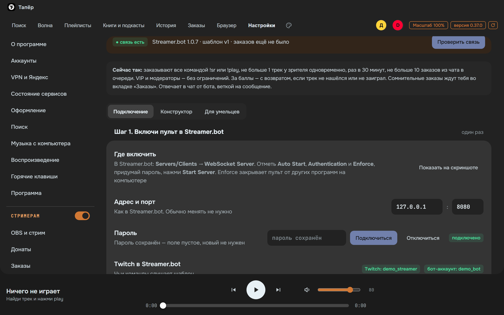
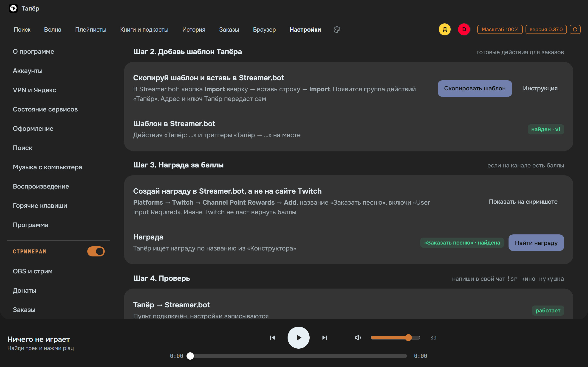
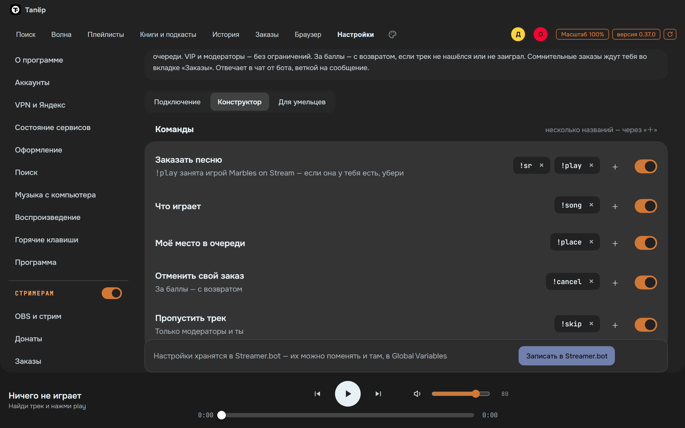
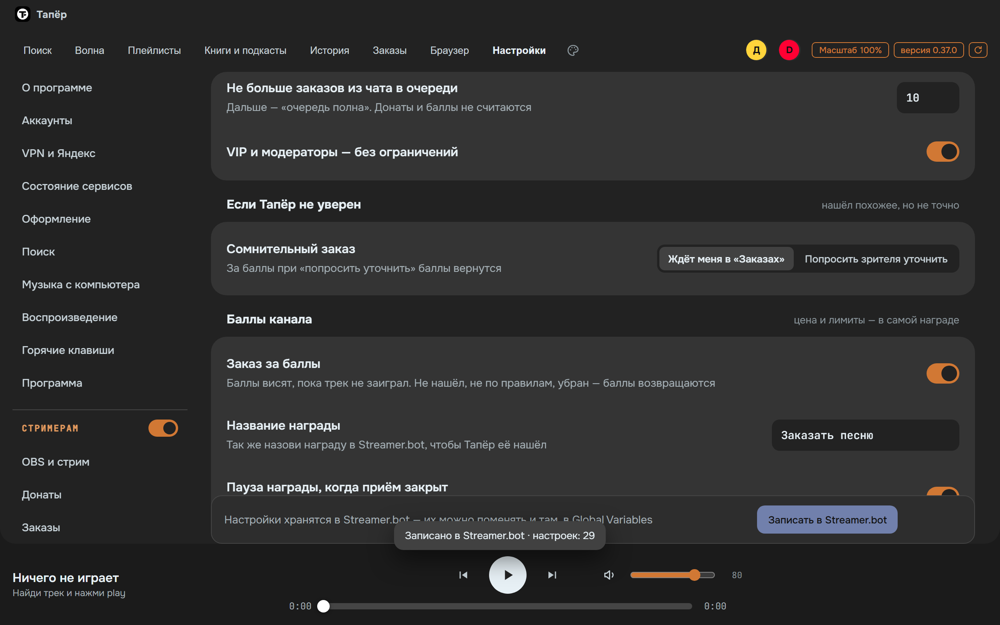
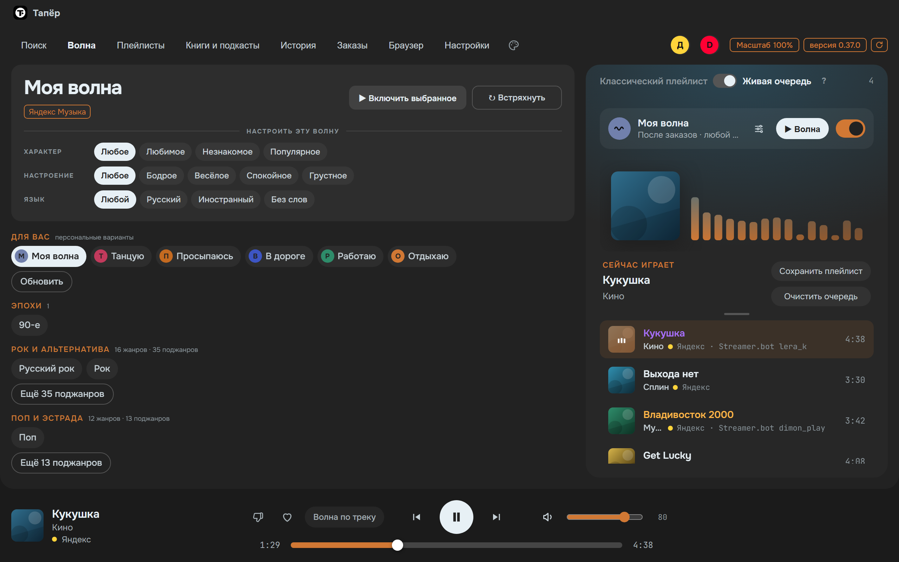
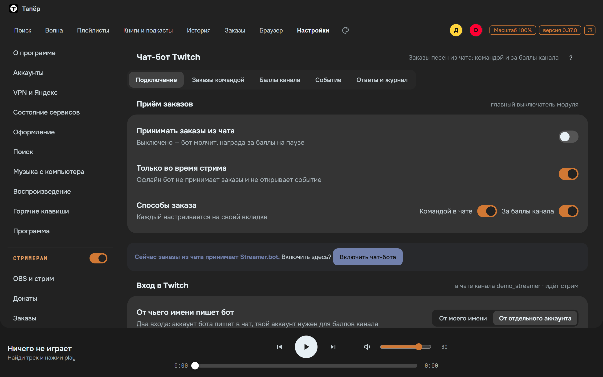
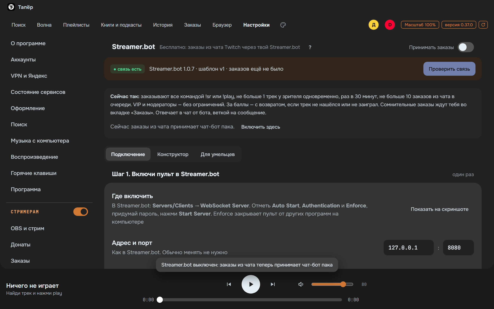
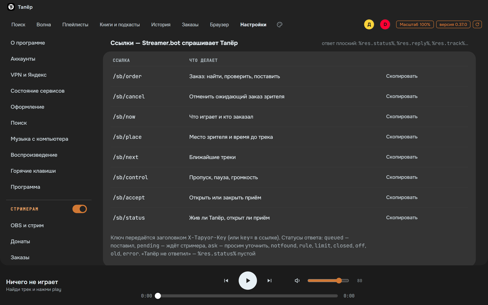
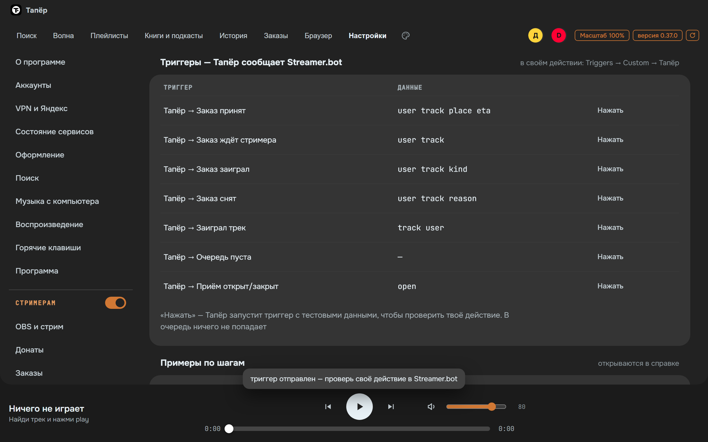

# Streamer.bot: заказы песен из чата Twitch

Простая инструкция: как включить в Тапёре приём заказов из чата через Streamer.bot, поставить шаблон,
проверить команды и что делать, если что-то молчит. Проверено 12.11.2026 со Streamer.bot 1.0.7 и шаблоном v1.

Если ты не хочешь Streamer.bot — ничего включать не нужно: заказы из чата по-прежнему принимает чат-бот пака
(если он у тебя стоит) или не принимает никто. Тапёр сам в чужой чат не пишет.

## Что получится

- Зритель пишет в твой чат `!sr кино кукушка` — Тапёр ищет трек, ставит его в очередь и отвечает в чат.
- Работают команды `!song` (что играет), `!place` (место в очереди), `!cancel` (отменить свой заказ),
  `!skip` (пропустить трек — только тебе и модераторам).
- Если на канале есть баллы — можно сделать награду «Заказать песню»: баллы списываются и возвращаются,
  если трек не нашёлся или не заиграл.
- Всё это — на твоём компьютере. Тапёр и Streamer.bot общаются через `127.0.0.1`, наружу ничего не уходит.

## Что нужно заранее

1. **Streamer.bot 1.0.7 или новее** — установлен и в нём подключён твой Twitch-канал.
2. **Тапёр 0.35 или новее** — запущен, музыка играет.
3. **Свой чат Twitch** — проверять команды нужно в нём (в чужом чате шаблон не отвечает).
4. **Пять минут времени** — один раз настроить.

> **Важно про Nightbot и других ботов.** Если у тебя уже есть бот, который ставит песни по `!sr`
> (Nightbot и подобные), на `!sr` ответят двое: и он, и Тапёр. Выключи у него заказы песен **или** поменяй
> команду Тапёра в «Конструкторе» (например, на `!заказ`). Ниже есть отдельный раздел.

## Шаг 1. Включи пульт в Streamer.bot

Это «дверь», через которую Тапёр разговаривает со Streamer.bot. Делается один раз.

1. Открой Streamer.bot.
2. Слева: **Servers/Clients → WebSocket Server**.
3. Поставь галочки:
   - **Auto Start** — сервер запускается вместе со Streamer.bot;
   - **Authentication** — вход по паролю;
   - **Enforce** — без пароля не пускать другие программы.
4. Придумай пароль и впиши его в поле **Password**. Запомни его — он понадобится в Тапёре.
   Не бери пароль от Twitch или от чего-то важного: это отдельный пароль для связи программ.
5. Нажми **Start Server**. Адрес и порт обычно уже стоят `127.0.0.1` и `8080` — их менять не нужно.

Почему **Enforce**: без него любая программа на компьютере сможет запускать действия в Streamer.bot.
С ним — только тот, кто знает пароль.

## Шаг 2. Подключи Тапёр

1. В Тапёре: **Настройки → Стримерам** (переключатель «Стримерам» должен быть включён).
2. Слева выбери **Streamer.bot**, вкладка **Подключение**.
3. Проверь адрес `127.0.0.1` и порт `8080`.
4. Впиши пароль из шага 1 и нажми **Подключиться**.
5. Должно появиться: **«связь есть · Streamer.bot 1.0.7»**, а справа — твой ник Twitch.
   Пока шаблон не импортирован, будет написано «шаблон не найден» — это нормально, идём дальше.

Если написано «Streamer.bot не отвечает» — проверь, что в Streamer.bot нажат **Start Server**, пароль
совпадает, и что обе программы на одном компьютере. Чужой адрес Тапёр не принимает — это защита.



## Шаг 3. Добавь шаблон в Streamer.bot

Шаблон — это готовые действия и триггеры. Их не надо собирать руками.

1. В Тапёре, на той же вкладке **Подключение**, найди **«Шаг 2. Добавь шаблон Тапёра»** и нажми
   **«Скопировать шаблон»**. Появится «Шаблон скопирован — вставь его в Streamer.bot кнопкой Import».
2. В Streamer.bot нажми вверху **Import**.
3. Вставь строку из буфера обмена: `Ctrl+V` (или правой кнопкой → «Вставить»).
4. Нажми **Import**.
5. Streamer.bot предупредит, что в шаблоне есть код C#. Это наши действия, код проверен. Нажми **Да / Yes**.
6. Появится группа действий **«Тапёр»**. Внутри — действия «Тапёр: …» и действие
   **«Тапёр: шаблон v1»** (по нему Тапёр понимает версию).
7. **Перезапусти Streamer.bot** (закрой и открой). После перезапуска в меню триггеров появятся
   **Custom → Тапёр** — «Заказ принят», «Заказ ждёт стримера», «Заказ заиграл» и другие.
8. Вернись в Тапёр и нажми **«Проверить связь»**. Должно быть «Связь есть, обе стороны работают»,
   а в строке шаблона — **«найден · v1»**.



**Наши действия не править.** Свои шаги добавляй в **свои** действия, которые запускаются на триггерах
Custom → Тапёр. Если менять действия «Тапёр: …», при обновлении шаблона правки пропадут — импорт
перезаписывает одноимённые действия.

## Шаг 4. Награда за баллы (если на канале есть баллы)

Этот шаг можно пропустить: команды из чата работают и без баллов. Награда нужна, только если хочешь
принимать заказы за баллы канала.

> Награды за баллы доступны каналам-компаньонам (партнёрам и партнёрам-новичкам). Если твой канал не
> компаньон, пропусти этот шаг — остальное работает.

1. В Streamer.bot: **Platforms → Twitch → Channel Point Rewards → Add**.
2. Название — **«Заказать песню»** (или своё, но точно такое же потом впиши в Тапёре).
3. Включи **User Input Required** — зритель пишет название песни.
4. Создавай награду **в Streamer.bot**, а не на сайте Twitch. Иначе Streamer.bot не сможет вернуть баллы,
   если трек не нашёлся.
5. В Тапёре: **Конструктор → Название награды** — впиши то же название и нажми **«Записать в Streamer.bot»**.
6. На вкладке **Подключение** нажми **«Найти награду»**. Должно появиться «… · найдена».

Баллы списываются сразу и возвращаются, если трек не заиграл: не нашёлся, не подошёл по правилам или его
убрали. Если Тапёр был закрыт и заказ не успел заиграть — баллы тоже вернутся при следующем запуске.



После правок в конструкторе нажми **«Записать в Streamer.bot»**. Настройки живут в Streamer.bot
(Global Variables), Тапёр их только показывает и записывает.



## Шаг 5. Проверь в своём чате

Напиши в **свой** чат Twitch (не в чужой):

| Команда | Что должно быть |
|---|---|
| `!sr кино кукушка` | «@ты поставил: КИНО — Кукушка, через ~N мин. Если песня не та — !cancel» |
| `!song` | «Сейчас играет: …» или «Сейчас ничего не играет» |
| `!place` | «@ты, … — N-й, через ~M мин» |
| `!cancel` | снимает **ожидающий** заказ; играющий не снимается |
| `!skip` | «Пропустил: …» — только ты и модераторы |

Если очередь пуста, заказ начнёт играть сразу: «ставлю: … — играет сейчас». Это нормально.



**Стример и VIP без ограничений.** У тебя и у VIP/модераторов (если в конструкторе включено «VIP без
ограничений») нет лимита «один трек на зрителя» и потолка очереди. У обычных зрителей — есть; лимиты
настраиваются в «Конструкторе».

## Если команды отвечают дважды

- **Nightbot или другой бот ставит песни по `!sr`.** Выключи у него заказы песен **или** поменяй команду
  Тапёра: «Конструктор → Заказать песню» — убери `!sr` и добавь свою (например, `!заказ`). Тогда на `!sr`
  отвечает только один бот.
- **`!play` занята игрой Marbles on Stream.** Если она у тебя есть — убери `!play` из команды заказа в
  конструкторе, оставь только `!sr` (или свою команду).
- **Два ответа на одну команду** — значит, включены и бот пака, и Streamer.bot. Приём заказов может быть
  только у одного: переключи «Принимать заказы» на экране Streamer.bot или в «Модули → Чат-бот».

## «Плеер сейчас не принимает заказы»

Так отвечает шаблон, когда Тапёр не может принять заказ. Проверь по порядку:

1. **Тапёр запущен?** Если закрыт — заказы не принимаются, шаблон честно говорит об этом.
2. **Включён приём?** Сверху экрана Streamer.bot — тумблер **«Принимать заказы»**.
3. **Кто принимает заказы из чата?** Должно быть **Streamer.bot**, а не «чат-бот пака» и не «никто».
4. **Связь есть?** На экране — зелёная точка и «связь есть». Если нет — шаг 2 и «Проверить связь».
5. **Шаблон импортирован?** Должно быть «найден · v1»; если «не найден» или «есть новее» — шаг 3.
6. **Команда включена?** В «Конструкторе» у нужной команды переключатель должен быть включён.
7. **Приём не закрыт вручную?** Если тумблер «Принимать заказы» выключен, порт отвечает `off`.
8. **Подожди пару секунд.** Поиск идёт до 8 секунд; если не успел, Тапёр пишет «ищу … — отвечу в чате»
   и присылает ответ позже, в течение двух минут.

Если ничего не помогло — открой **Настройки → Программа → Открыть папку данных**, там `log.txt`.
Строки «Streamer.bot: …» подскажут, на каком шаге застряло. В логе нет пароля и ключа.

## Как вернуться на чат-бота пака

1. На экране **Streamer.bot** выключи тумблер **«Принимать заказы»** сверху. Или:
2. **Настройки → Модули → Чат-бот → «Принимать заказы из чата»** — включи там.

После этого заказы из чата снова принимает бот пака (если он установлен и куплен/пробный период идёт).
Шаблон Streamer.bot при этом **молчит**: на все команды Тапёр отвечает ему `off` с пустым текстом.
Награда за баллы в Streamer.bot ставится на паузу, чтобы зрители не тратили баллы зря.





Обратно на Streamer.bot — тем же тумблером. Тумблеры в двух местах показывают одну и ту же настройку,
поэтому «включено» может быть только в одном месте.

## Как обновлять шаблон

Когда выйдет новая версия Тапёра с новым шаблоном, на экране появится **«найден · v1 · есть новее v2»**.

1. Нажми **«Скопировать шаблон»**.
2. В Streamer.bot — **Import** → вставь → **Import** → **Да** на предупреждение про C#.
3. Перезапусти Streamer.bot, чтобы обновились триггеры.
4. В Тапёре снова «Проверить связь» — версия должна стать новой.

Импорт перезаписывает **наши** действия «Тапёр: …». Твои собственные действия на триггерах
Custom → Тапёр не трогаются. Поэтому своё — только в свои действия.

## Что не надо делать

- Не переименовывай группу «Тапёр» и действия «Тапёр: …» — Тапёр ищет их по именам.
- Не добавляй свои шаги внутрь наших действий — потеряются при обновлении.
- Не вписывай адрес и ключ Тапёра руками в шаблон — Тапёр передаёт их сам при подключении.
- Не показывай ключ порта (`tp_…`) на стриме и не выкладывай скриншот с нажатой кнопкой «Показать».
- Не запускай два Streamer.bot и не включай два приёмщика заказов одновременно.

## Данные и приватность

- Тапёр и Streamer.bot работают на одном компьютере: адрес только `127.0.0.1`/`localhost`/`::1`.
- Пароль пульта хранится зашифрованным средствами Windows и не пишется в журнал, отчёт и окно.
- Ключ порта (`tp_…`) тоже хранится зашифрованным; в окне он скрыт точками.
- Журнал заказов из Streamer.bot (`sbot-journal`) лежит в папке данных Тапёра, хранится 7 дней и никуда
  не отправляется. Ники и тексты заказов есть только там — не в общем логе и не в отчётах об ошибках.
- Недоставленные события заказов лежат в `sbot-mailbox.json` в папке данных, не дольше суток
  (поздний ответ — не дольше двух минут), и никуда не отправляются.

Подробнее — `PRIVACY.md` в папке программы.

## Для умельцев

Это краткая справка. То же самое есть в Тапёре: **Streamer.bot → Для умельцев**, там ссылки и кнопки
«Скопировать», а у триггеров — «Нажать» для проверки своего действия с тестовыми данными.

### Ссылки (Streamer.bot → Тапёр)

Адрес: `http://127.0.0.1:<порт>` (порт бывает не 47654, если тот занят). В Streamer.bot адрес и ключ
лежат в глобальных переменных **`~tapyorUrl~`** и **`~tapyorKey~`**. Шаг — **Fetch URL**, галочка
**Parse result as JSON**, только GET. Ключ — заголовок **`X-Tapyor-Key`** или параметр `key=`.

| Ссылка | Параметры | Что делает |
|---|---|---|
| `/sb/order` | `user`, `uid`, `platform`, `kind` (`cmd`/`points`), `text`, `cmd`, `msg`; для баллов `reward`, `redemption`; `perUser`, `chatCap`, `doubt`, `free`, `v` | найти, проверить и поставить заказ |
| `/sb/cancel` | `user`, `uid`, `platform`, `v` | снять ожидающий заказ (играющий не снимается) |
| `/sb/now` | `v` | что играет и кто заказал |
| `/sb/place` | `user`, `uid`, `platform`, `v` | место зрителя и время до трека |
| `/sb/next` | `n` (до 5), `v` | ближайшие треки |
| `/sb/control` | `user`, `do` (`skip`/`pause`/`play`/`vol`), `value`, `v` | управление плеером |
| `/sb/accept` | `on` (`1`/`0`) | открыть или закрыть приём |
| `/sb/status` | — | Тапёр жив, приём открыт, сколько заказов, версия |
| `/sb/ack` | `id` | подтверждение доставки события шаблоном |
| `/sb/ping` | — | «Проверить связь» |

`text` — `%rawInputUrlEncoded%`. Тапёр сам отрезает первое слово, если оно совпадает с `cmd`.
Нет `perUser`/`chatCap`/`doubt` — берутся безопасные значения 1 / 10 / `wait`, а не «без ограничений».

### Ответ — всегда плоский JSON

```json
{ "status": "queued", "reply": "@zritel_1, Кино — Кукушка — 3-й, через ~8 мин. Отменить: !cancel",
  "orderId": "sb-7f3a", "track": "Кино — Кукушка", "artist": "Кино", "title": "Кукушка",
  "place": 3, "etaMin": 8, "reason": "", "refund": false, "tapyor": "0.35.0", "templateOk": true }
```

Вложенных объектов и массивов нет — Streamer.bot надёжно разбирает только плоские поля
(`%res.status%`, `%res.reply%`, `%res.track%`, …).

| `status` | Что значит |
|---|---|
| `queued` | поставил в очередь |
| `pending` | сомнительный заказ, ждёт стримера в «Заказах» |
| `ask` | сомнительный заказ, просим зрителя уточнить (`doubt=ask`) |
| `notfound` | не нашёл |
| `rule` | не подходит по правилам трека (`reason` — почему) |
| `limit` | у зрителя уже ждёт трек или очередь полна |
| `closed` | приём закрыт |
| `off` | заказы из чата принимает бот пака — шаблон **молчит** |
| `old` | шаблон устарел (`reply`: «обнови шаблон Тапёра») |
| `error` | ошибка |
| `search` | поиск дольше 8 секунд, ответ придёт позже в чат |
| `playing` | у зрителя играющий заказ (`/sb/place`, `/sb/cancel`) |
| `cancelled` | заказ снят |
| `nothing` | снимать нечего |
| `none` | ничего не играет / нет заказа |
| `ok` | команда выполнена |

`refund: true` — для заказа за баллы баллы надо вернуть (`notfound`, `rule`, `limit`, `closed`, `ask`,
`error`). `templateOk: false` — версия шаблона старая, но совместимая.

### Триггеры

`ExecuteCodeTrigger`, в своём действии: **Triggers → Custom → Тапёр**. Данные — плоские `args`,
доступны как `%имя%`. «Нажать» на вкладке «Для умельцев» присылает тестовые данные: `orderId`
вида `test-<время>`, `kind: "cmd"`, `etaMin`.

| Триггер | Данные |
|---|---|
| `tapyor_order_queued` | `orderId`, `user`, `uid`, `kind`, `track`, `place`, `etaMin` |
| `tapyor_order_pending` | `orderId`, `user`, `uid`, `kind`, `track` |
| `tapyor_order_played` | `orderId`, `user`, `uid`, `kind`, `track`, `artist`, `title` |
| `tapyor_order_dropped` | `orderId`, `user`, `uid`, `kind`, `track`, `reason` |
| `tapyor_track_started` | `track`, `user` (ник, если играет заказ) |
| `tapyor_queue_empty` | — |
| `tapyor_accept_changed` | `open` (`1`/`0`) |

Для баллов в событиях ещё есть `reward` и `redemption` (номера награды и списания).





### Примеры

- **Кнопка «пропустить» на Stream Deck** — Fetch URL → `/sb/control?do=skip`.
- **«Сейчас играет» в чат раз в 10 минут** — Fetch URL → `/sb/now`, ответ `%res.reply%`.
- **Алерт в OBS, когда заиграл заказ** — своё действие на триггере «Тапёр → Заказ заиграл».
- **Сменить сцену, когда заказы кончились** — своё действие на триггере «Тапёр → Очередь пуста».
- **Другая площадка (YouTube, Kick)** — на свой страх: Тапёр это официально пока не поддерживает.

**Наши действия не править.** Своё — в свои действия на триггерах Custom → Тапёр. При обновлении шаблона
наши действия перезаписываются, а твои — нет.

### Служебная переменная `tapyorOn`

Тапёр пишет в Streamer.bot глобальную переменную `tapyorOn`: `1` — заказы из чата принимает
Streamer.bot, `0` — бот пака или никто. Это **только для показа** (видно в Streamer.bot → Global Variables). Сам шаблон её не читает: при выключенном режиме он по-прежнему получает `off` и молчит.
